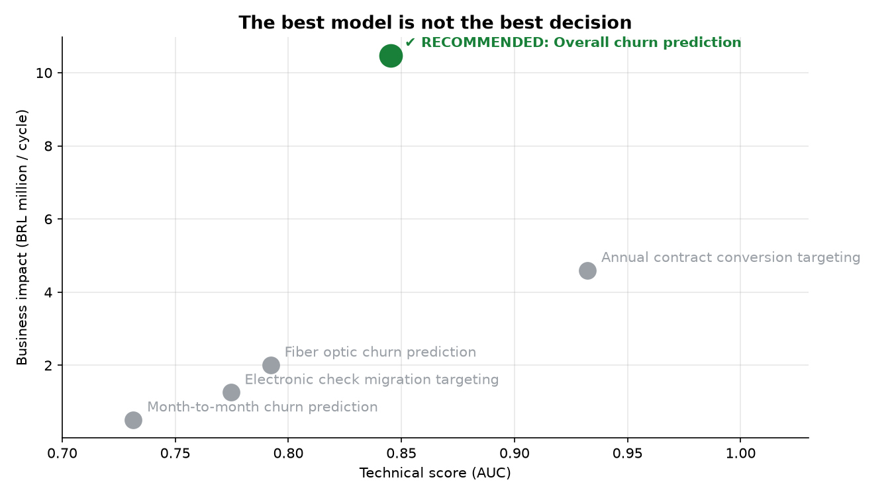
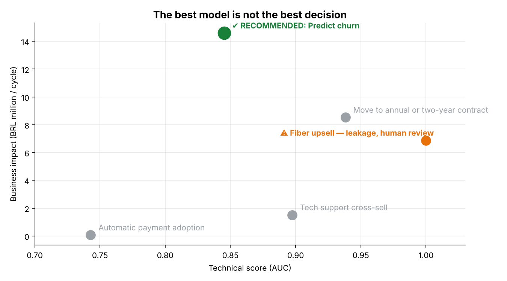

# 🧭 beyond-automl

**A real LLM proposes business problems, code guardrails check them, 20 models are trained — and the winner is chosen by business value, not by AUC.**



## Results in 30 seconds

```
LLM (DeepSeek via OpenRouter, US$ 0.003) proposed 8 problems → 8 passed the guardrails → top 5 × 4 algorithms = 20 models → 1 recommendation
```

| | Finding |
| --- | --- |
| ✅ **Recommended** | **Overall churn prediction** — AUC 0.845, **BRL 10.5M per cycle**, ~2.3× the runner-up |
| 📈 **Highest AUC (0.935)** | Annual contract conversion — technically the best model, but only BRL 4.6M |
| 🛡️ **Guardrails** | The live LLM made no detectable mistakes; a [guardrail demo](#guardrail-demo-offline-cache) with a deliberately flawed response shows what they catch |

**Takeaway:** ranking by AUC would have picked contract conversion. Ranking by business value picks churn: a 0.09 AUC gap matters far less than the value of each retained customer.

**▶ See the full experiment with outputs: [`beyond_automl.ipynb`](beyond_automl.ipynb)**

---

## How it works

| Step | What happens |
| --- | --- |
| 1 · Data | [IBM Telco Customer Churn](https://github.com/IBM/telco-customer-churn-on-icp4d), 7,043 customers. Only an aggregated profile (no rows) goes to the LLM |
| 2 · LLM Analyst | Proposes 8 problems with target, population and BRL assumptions (OpenRouter) |
| 3 · Guardrails | Code validates each suggestion (table below) |
| 4 · Modeling | Top 5 by LLM impact score × Logistic Regression, Random Forest, XGBoost, LightGBM |
| 5 · Technical ranking | AUC, F1, Precision, Recall |
| 6 · Business ranking | `profit = TP × value_per_hit − (TP + FP) × cost_per_action`, best threshold, gain over no model, scaled to 1M customers |
| 7 · Recommendation | Highest business gain among problems that passed every check |

### Live run: 5 modeled problems

| Problem | Best model | AUC | Value/hit (LLM) | Impact/cycle* |
| --- | --- | --- | --- | --- |
| Overall churn prediction | LogisticRegression | 0.845 | BRL 1,200 | **BRL 10.5M** |
| Annual contract conversion targeting | XGBoost | 0.932 | BRL 300 | BRL 4.6M |
| Fiber optic churn prediction | LogisticRegression | 0.792 | BRL 1,500 | BRL 2.0M |
| Electronic check migration targeting | RandomForest | 0.775 | BRL 80 | BRL 1.3M |
| Month-to-month churn prediction | XGBoost | 0.731 | BRL 1,000 | BRL 0.5M |

\* Gain over the best no-model alternative (act on everyone or no one), extrapolated to 1 million customers. Also proposed but not modeled (lower impact score): tech support upsell, paperless billing, multiple lines.

| Run details | |
| --- | --- |
| LLM | `deepseek/deepseek-v4.1-flash` (picked by `openrouter/auto`) |
| Tokens / cost | 7,961 tokens (70% reasoning) / US$ 0.0028 |
| Runtime | 203 s, mostly waiting for the LLM |
| Raw LLM response | [`problems/llm_live_response.json`](problems/llm_live_response.json) |

## Guardrail demo (offline cache)

Without an API key, the notebook uses [`problems/llm_problems_cache.json`](problems/llm_problems_cache.json): a hand-written response **with typical LLM mistakes on purpose**. In that run the guardrails rejected 3 of 8 problems and sent the highest-AUC model (1.000) to human review as a data leak.

| Generative-AI shortcoming | Check | Caught in the demo |
| --- | --- | --- |
| Hallucinates | Target column and values exist | `PaymentDefault`, `NumComplaints` ❌ |
| Unreliable | JSON schema + BRL assumptions ≤ 24 months of ARPU | BRL 50,000 per hit ❌ |
| Bias | Sensitive attributes never target nor feature; recall gap between groups | target `SeniorCitizen` ❌ |
| Still learning | Leakage: single-feature AUC ≥ 0.95 dropped; model AUC > 0.98 → human review | Fiber upsell × `MonthlyCharges` ⚠️ |
| Privacy | LLM sees only schema and statistics; IDs removed | `customerID` |
| Complexity | Prevalence 3–97%, ≥ 100 positives | — |



## Run it

```bash
pip install -r requirements.txt
jupyter lab beyond_automl.ipynb   # runs everything, writes results/
streamlit run app.py              # interactive dashboard
pytest -q                         # guardrail tests
```

Live LLM: copy `.env.example` to `.env` and set `OPENROUTER_API_KEY` (model via `OPENROUTER_MODEL`, default `openrouter/auto`). Without a key, the guardrail demo runs.

<details>
<summary>Project structure</summary>

```
beyond-automl/
├── beyond_automl.ipynb          # main notebook: the whole experiment
├── app.py                       # Streamlit dashboard
├── config.yaml                  # assumptions and guardrail limits
├── problems/
│   ├── llm_live_response.json   # live LLM output used in the results above
│   └── llm_problems_cache.json  # flawed example for the guardrail demo
├── src/beyond_automl/           # data, llm, guardrails, modeling, business
├── results/                     # leaderboards and recommendation (live run)
├── assets/                      # README charts
└── tests/
```
</details>

<details>
<summary>Limitations (MVP)</summary>

- The ranking depends on the LLM's BRL assumptions: churn wins largely because it values a hit at BRL 1,200 vs BRL 300 for contract conversion.
- 3 of the 5 modeled problems are churn variants; problem diversity is not enforced yet.
- The threshold is optimized on the test set itself (optimistic); a validation split is the next step.
- Targets are "who already has X" (cross-sectional data): a propensity proxy, not real conversion.
- `MonthlyCharges` is treated as BRL for readability.
- Results with `openrouter/auto` may vary between runs, since the router can pick a different model.
</details>
